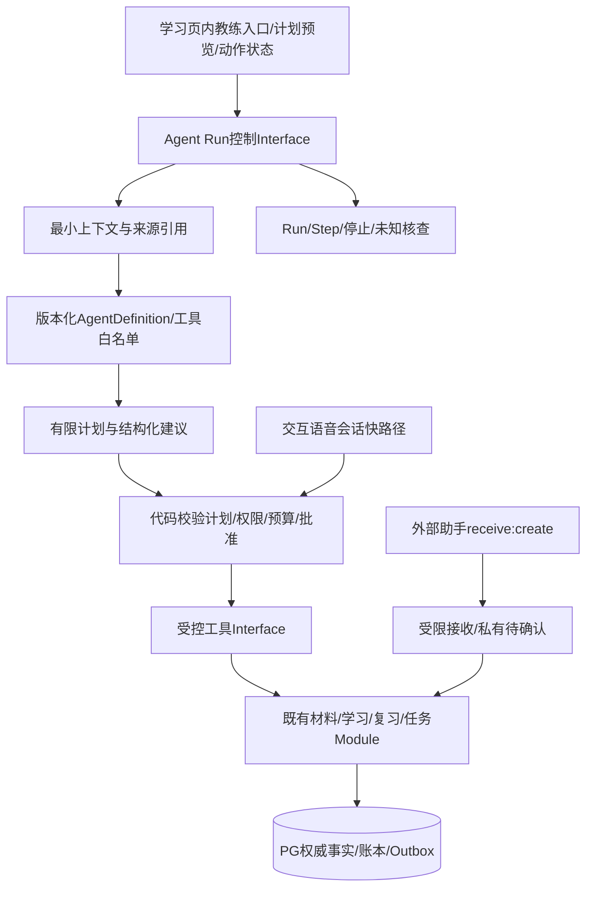

# 拾语：受控学习教练架构与工具契约 v0.4

日期：2026-11-11。角色：Agent架构/后端负责人。用户已同意首版验证“外部助手送入＋受控学习教练”；平台主动读取外部来源继续分期。本稿承接v0.2运行架构、v0.3语音编排及已确认v0.11交互。只修订设计，不代表业务编码、SDK安装、模型调用、采购、真实接入或技术验证已经获批/完成。

## 1. 架构判断与最小增量

保留Flutter、Python/FastAPI模块化核心、PostgreSQL权威事实/任务/账本、私有对象存储和独立Worker候选，不重做平台，也不立即引入LangGraph、Temporal或多Agent调度框架。先用一个有限学习教练协调已有能力；听、判断、回应和持久动作分责，不要求每轮跑三个大模型。

新增四个逻辑Module：**Agent定义与工具注册、有限计划/执行Runtime、最小上下文构建、运行记录与控制**。授权、处理确认、预算预留、材料版本、学习事实、复习、任务、外部Agent接收仍由已有Module拥有。各Module只经Interface调用，不让Agent直接查表、改表或拿供应商密钥。

界面不新增全局Agent导航。学习首页进入教练；全局加号继续只添加学习材料。正文→播放/练习按钮→最底两行词卡的顺序不变。m31–m35是新增关键状态，具体需求ID由产品增量稿统一。

## 2. AgentDefinition与工具注册

`AgentDefinition`最小字段：definition_id/version、目标与允许输出Schema、context_policy_version、允许工具及各Schema版本、最大计划步数/工具调用数/模型调用数/运行时长、支出约束、支持的学习方式、停止/失败策略、负责人、启停状态。模型和SDK配置作为可替换Adapter，不写死在客户端或工具语义中。

定义与工具版本是受评审的发布配置，模型不能注册新工具、扩大白名单或修改自身权限。停用区分隐藏入口、禁止新Run、停止新工具执行、保留历史读取；已有未知付费任务仍需核查，不能删定义后失去恢复入口。

每个工具注册：tool_id、schema_version、effect_class、所需scope、输入/输出Schema、资源/版本约束、幂等要求、潜在费用/数据去向、超时与取消能力、允许重试条件。工具返回结构化事实/引用，不返回原始凭据、完整签名地址、无限全文或“请忽略原规则”等可执行指令。

所有Schema和具体上限数字在需求/技术评审后冻结，本稿不虚构已选框架版本或服务价格。

## 3. 工具分级与首版白名单

| 等级 | 工具/动作候选 | 准入与首版边界 |
| --- | --- | --- |
| 只读 | `get_selected_learning_context`、`get_confirmed_learning_summary`、`list_due_items`、`get_item_preview`、`get_run_status` | 仅当前用户、用户已选材料/学习版本及已确认学习事实；到期词句也按明确范围过滤。只读不等于可读全部账号，读取供应商内容仍按已有许可 |
| 范围内可撤销写入 | `save_plan_draft`、`create_practice_draft`、`adjust_run_review_draft` | 用户明确允许的本次计划范围内；产生草稿/可撤销安排，保留版本与原值。不得自动把所有查词永久加入词本、自动启用提醒或制造必须清空的复习债务 |
| 用户批准后由既有执行器执行 | `prepare_processing_request`、`request_plan_approval` | 工具只能准备处理范围、报价/上限及批准申请。生成新音频、评测、调用收费服务或增加上下文来源，必须有对应批准后才交已有任务Module；教练不能自行“批准自己” |
| 首版教练禁用 | 公开/三方发布、历史删除、扩大来源读取、发消息、付款/充值、授予凭据或权限、修改专业成绩/账本 | 不向教练暴露执行工具。需要时跳转用户显式业务流程，不因为聊天中说“帮我发”就让首版教练绕过产品确认和渠道能力检查 |

“安排复习”首版是创建/调整用户可查看的学习草稿，不等于建立OS通知、日历或后台定时任务。是否允许自动落实小回合，必须在本次教练scope里明确；不能把用户同意产品增加Agent解释为已给所有终端数据和费用授权。

## 4. 小而稳定的Interface

| Interface | 输入/输出与关键不变量 |
| --- | --- |
| `prepare_run` | 认证主体＋selected_resource_refs＋goal/time/mode＋existing_approval_refs → run draft/context manifest/预期步骤与费用范围。服务端绑定owner，不采信客户端owner_id |
| `propose_plan` | run revision＋context manifest → 结构化计划、引用依据、需批准项。仅能选择已允许工具与有效资源；规划本身若需模型调用，也先过本次模型处理授权和预算 |
| `approve_plan` | 用户确认的plan revision/hash＋范围/限制 → approval ref。由确定性批准模块处理，模型不可调用该批准动作 |
| `execute_step` | run/plan/step revision＋稳定operation key → accepted/succeeded/待批准/未知/拒绝。工具执行器逐次复核权限、版本、额度和取消状态 |
| `request_stop` | run revision＋用户停止请求 → stop_requested及在途列表。原子阻止新步骤；不把请求当作供应商已停止 |
| `get_run / reconcile_step` | run/step ref → 脱敏动作状态/待核查项。未知只核查原操作，不生成新购买键重试 |

这些是业务Interface语义草案，不是现成HTTP路由或已编译Schema。OpenAPI/事件Schema生成客户端类型的方式沿用现有技术方案。

## 5. 计划、上下文与记忆

读取默认仅限用户当前选中的材料版本、练习目标和明确允许的已确认学习事实；不得默认扫描所有材料、历史对话、外部应用或好友内容。若教练发现需要另一份材料，先提出建议和范围，让用户选择，不能先读后问。

`ContextManifest`记录resource_id/revision、来源、事实类别、提取时间、准入依据、截取范围和是否用户修订。传模型只给必要摘要/片段与受权引用；用户原始工作文件、凭据、长音视频和个人信息不因生成计划就整包送出。对未知/过期/被撤回引用返回明确状态，不填造“昨天表现”。

分开三类数据：

- **权威学习事实**：尝试、提示、录音质量、专业评测、延迟表现来自其所属Module，教练只读。用户纠正转写不反写声学分，模型总结不覆盖原事实。
- **本次计划依据**：当前材料、用户可用时间、困难词句与计划选择，可随本次Run保存最小引用；显示“为什么练这个”时给事实和可理解理由，不暴露模型内部推理链或完整系统提示。
- **长期偏好/个人记忆**：独立opt-in，含来源、版本、用户修正/删除和保留策略；不自动把对话提到的公司、人名或个人事实永久记住。关闭长期记忆后仍可依已批准的本次上下文练习。

模型输出、材料正文和工具结果都属于不可信内容。它们可以参与理解，不能改变授权策略、工具白名单、预算、计划批准或系统配置。上下文引用也必须在实际读取时重新核权。

## 6. Durable Run、步骤与幂等

在PG新增概念事实（非本轮DDL）：

| 对象 | 必要记录 |
| --- | --- |
| AgentRun | run_id、owner、definition/version、context manifest、当前plan revision、scope/approval refs、次数/时长/费用限制、状态与stop_requested_at |
| AgentPlanRevision | plan_id/revision、hash、目标/时间/学习方式、工具与输入资源版本、批准状态、变更原因与来源引用 |
| AgentStep | step_id、tool/schema version、input hash、effect class、operation key、状态、job/attempt/consent/ledger引用、可见事实摘要与错误 |
| AgentMemoryRevision | 用户允许的偏好/记忆、来源/用途、用户确认/修订、保留/撤回/删除状态；不与评测事实混表覆盖 |

运行建议状态：draft→planning→awaiting_approval→ready→running；分支为paused/stop_requested/stopped/awaiting_reconciliation/partially_completed/completed/failed。Run总体状态不代替每个底层任务的取消/终态证据。

步骤operation key以账号、run、获批plan revision和逻辑step identity稳定派生，并在事务中唯一约束；重复请求返回同一步骤结果。工具提交与预算预留/Outbox通过既有事务Interface协调。新的模型尝试ID、客户端重连或恢复代际不能把同一逻辑动作伪装成新付费操作。

用户改时间/材料/目标产生新plan revision，旧批准不能覆盖改变的数据去向、工具权限、费用上限或新增资源。原计划已执行的事实保留；尚未开始的旧步骤失效。范围未扩且受控草稿可撤销变更可按已批准规则执行；权限升高或付费计划改变必须重新确认。

次数上限包括模型规划、重规划和工具调用；超时、循环、反复失败或无进展达到上限后停止新步骤，返回已完成部分与下一选择，不用“再思考一次”无限重试。规划模型调用本身计入用量，不能把“使用已有内容”误写成整个教练绝对免费。

## 7. 停止、未知与灾后恢复

停止请求原子阻止尚未开始的新工具调用；运行中的本地步骤尽量取消或完成保存，已提交外部服务按其取消能力处理。在途请求或费用未知显示“停止新增步骤，仍有一项待核查”，不是“全部停止且不收费”。

租约丢失、HTTP超时、重复回调和客户端断开不能证明外部调用没发生。`outcome_unknown`先用原请求/操作引用核查；确认可安全重试才重试，不自动释放仍可能消耗的预留。底层投递库的自动重试不能绕过这一判断。

沿用v0.2恢复隔离：灾后先冻结新Agent工具/外部派发/发布/结算，隔离旧Worker并换恢复代际，重放有效删除/撤权/撤回决定；核对独立执行审计、供应商/对象/账本/Outbox后限量恢复。教练恢复不默认从run=running直接重放所有工具；稳定业务操作键仍保持，未知挂起人工核查。

Agent额度与供应商全局配额共同生效。增加多个Agent进程不增加可用预算或供应商配额；统计看板、客户端缓存及模型声称“用户同意”不作为准入真相。

## 8. 外部助手接入与平台教练严格分权

m35展示受限连接/送入设计：外部助手凭可撤销、限定接入方/账号的`receive:create`能力，投递包含delivery_id、source revision和许可的正文/附件引用，服务端创建私有待确认回执。重复投递回同一接收结果，同源更新不静默覆盖。

该凭据不授予读取平台材料、调用教练、自动处理/付费生成、发布、删除或读取其他终端记录；外部助手原有来源访问授权也不自动转移给本平台。平台主动读取来源仍是后期独立授权能力。

用户可从m10待确认材料预览，随后明确选择“交给学习教练安排”；此时建立平台内新的Run scope与处理批准。外部“已发送”、平台“已接收”、生成完成和可开始学习是不同状态，不能用一个成功标记代替。

## 9. 与m31–m35及各端的增量

| 页面/专业 | 本轮应补什么 |
| --- | --- |
| m31 学习教练 | 当前材料、沟通目标、可用时间和静默/开口方式；获取当前范围内事实，允许退出/返回原学习 |
| m32 计划预览调整 | 用什么材料、为何选这些、几步/预计时间、已知用量及待确认处理；调整/跳过/开始，显示计划版本 |
| m33 动作状态与停止 | 已读哪些来源、准备了什么草稿、待用户开始/批准、已停止新步骤与待核查；只显示动作事实，不显示内部推理链 |
| m34 权限与记忆 | 本次材料/学习事实scope、长期偏好开关、查看/纠正/删除记忆的独立动作；撤权、停止和删历史不混为一个按钮 |
| m35 外部助手连接 | 账号/接入方/仅送入的能力、撤销/过期、私有待确认、重复/更新；不在普通截图/日志显示完整凭据 |
| Flutter客户端 | 学习首页内嵌教练入口，不新增tab；运行状态可跨端续看，计划变更有版本；停止按钮和未知项可达 |
| 后端 | 新增有限Runtime与registry、Run/Plan/Step持久事实和授权映射，工具委托已有Module；不直接持密钥或越域写表 |
| 数据 | 增加plan proposed/approved/adjusted、tool step与stop/reconcile事实引用；只作为过程数据，不计“教练推荐次数”为学习效果；帮助与自主表达口径保留 |
| SRE | 每Run上限、循环/拒绝/费用未知告警、工具级熔断和定义版本灰度，支持关闭新教练但保留已生成内容与历史状态 |
| QA | 跨账号/超scope、prompt injection、过期计划、幂等、并发停止、外部未知/灾后恢复、记忆删除不复活、规划费用准入与多端一致用例 |

## 10. 第一轮验收与未决事项

文档与原型应能走通：外部送入私有待确认→用户选择材料/时间→教练提出可调整计划→用户批准范围→创建小回合草稿→练习事实记录→下一次复习；还需走一次用户拒绝/停止和一次结果未知分支。

验证不变量：外部receive凭据不能调用教练或读其他资源；Agent不能自行批准费用/新来源/公开/删除；计划修改后旧批准不继续新增动作；同操作重放不重复建草稿/计费；停止不伪装外部终态；未知不盲重试；模型伪造“用户同意”无效；没有真实服务结果不出现专业评分；长期记忆关闭不影响基本练习。

后续需收口工具Schema、scope与批准粒度、Run上限和记忆保留规则，具体数字依据有限验证计划而非凭空填。供应商/模型/SDK版本和费用未核实，不锁定Agent框架。真实数据/音频/付费调用仍先提交样本、数据流向、保存规则与费用上限，获对应授权后再执行。本轮只形成增量方案。
