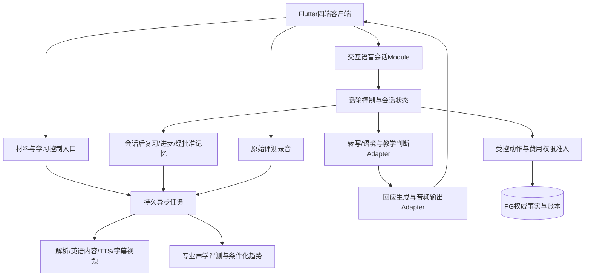

# 拾语：实时语音与教学编排补充方案 v0.3

2026-11-11。依据本轮同行公开架构研究提出，供产品/架构评审。是对既有R18交流与表达能力的技术分责补充，不自动新增全天语音通话、虚拟头像或改动已经确认的原型，不表示已选择LiveKit或允许外发音频。

## 1. 两条路径

连续实时媒体不经普通后台队列逐帧/逐轮串行排队；队列仍承接可延迟的生成、后处理和专业评测。实时会话也不能绕过身份、预算、供应商全局限流和原始记录规则。

## 2. 最小职责，不等于增加多个大模型

| Module | 应负责 | 不应负责 |
| --- | --- | --- |
| 会话/话轮 | 当前轮次、结束/中断、用户帮助、断线与输出代际 | 从模型一句话推导公开/删除/付费授权 |
| 转写与教学判断 | 根据可信输入生成理解、纠正候选与回应约束，表达不确定性 | 把识别错字直接认作发音错误，或把语法判断当声学准确率 |
| 说话/回应 | 基于当前材料和受控上下文，生成适合用户的自然回应 | 自行写长期记忆、词本、成绩、账本或发送到社交平台 |
| 受控动作 | 校验账号、资源版本、允许动作、批准范围和预算后持久化 | 接受文档/模型输出中的任意工具指令 |
| 复习/规划 | 根据已确认尝试、提示和评测安排后续小回合 | 每轮必跑多个高价模型、以总结覆盖原始事实 |

首版判断可使用规则和单次结构化输出，只有需要时调用独立模型。职责分开可以在同一进程内用清楚Interface实现，不默认每个角色变成微服务。

## 3. 交互路线分期候选

- **先验证短录音回应**：用户主动开始、点“说完了”提交，可慢放/重听/请求提示。容忍思考停顿，结束后返回回应和有限反馈；可用既有任务状态，不承诺无间断全双工。
- **连续免手对话再评实时传输**：候选包括LiveKit/WebRTC与可替换的流式能力；需验证网络、TURN/媒体服务、四端权限/音频焦点、打断、费用、地域和保存政策。LiveKit官方Flutter SDK声明跨Flutter平台，只有集成路径证据，不能替代四端真机和本地录像验证。
- **自动话轮检测另有门槛**：非母语停顿、重启、中英混合和请求重复有专门样本，不能用固定短静音一刀切。新规则可先在经批准数据上旁路评估，未通过不改变用户流程。

本轮不购买LiveKit Cloud、不自建媒体集群、不训练话轮或头像模型。来源：https://github.com/livekit/client-sdk-flutter ；Speak工程参考见同行对比文。

## 4. Interface需要补的状态和字段

会话至少有session_id、owner、learning_revision、approved_context、capture_profile、transport/region、quota/consent引用。话轮有turn_id、sequence、input_finality、assistance、转写/判断版本、输出代际与可追溯结果。标识归属由后端验证，不能相信客户端随意指定owner。

状态区分准备/权限待确认/听取/转写/判断/回应/用户打断/断线/结束；不压成一个loading。用户打断后停止旧音频播放、作废旧输出代际；供应商已开始的调用按能力取消或核查费用，不把用户听不到解释成供应商未收费。

确定性写入使用稳定业务操作键并受控去重。模型只能给纠错/收藏/记忆建议，后台验证后执行。会话后异步结果绑定原话轮，不能乱序覆盖用户刚修订的内容。

## 5. 反馈、记忆与隐私

- 区分“没听清”“说法可接受”“语法/用词建议”和专业发音反馈。不确定转写、母语/混合语言和短样本不能强制纠错；允许用户纠正转写，但不重写原始声学证据。
- 单次优先反馈一两个最影响沟通的点；即时纠正与课后复习由学习目标决定，避免每句都打断。专业评分继续使用独立原音和已验证服务/任务条件。
- 默认只读取当前已授权材料和相关困难点。长期个人事实/偏好如需保存，必须有可解释的来源、修正/删除与保留政策，不自动总结并永久记住所有工作对话。
- 传输加密不等于服务端/模型不可读取；ASR/模型处理方与数据地域、训练使用和保留说明须具体核实，不能因用了WebRTC就宣称全链路端到端私密。

## 6. 验证与观测

用户体验计时起点为实际结束说话/提交，终点为客户端听到首个有效回复，另记录转写完成、判断、生成首输出、首音频及播放卡顿；按平台/网络/供应商和任务观察P50/P95/P99，不能拿同行转写p50当整体承诺。

同时观察误打断、重连/回声、误纠正、合理回应被否、帮助依赖、不可用样本、费用和预算拒绝。音频路由/信号处理变化纳入capture_profile，不直接混合专业趋势。观测只带脱敏引用和时序，不把原文/音频/凭证写进通用日志。

进入真实验证前提交：路线与依赖版本、四端设备、原始/合成/自愿样本、服务与地域、外发内容、保存和删除、最大输入/时长/次数与费用上限、预先通过/停止条件。当前只补方案，没有执行或结果。

本补充与v0.2全局准入、未知核查、恢复冻结对账、媒体撤回和运维设计共同生效；实时模型也不拥有绕过这些规则的权限。
