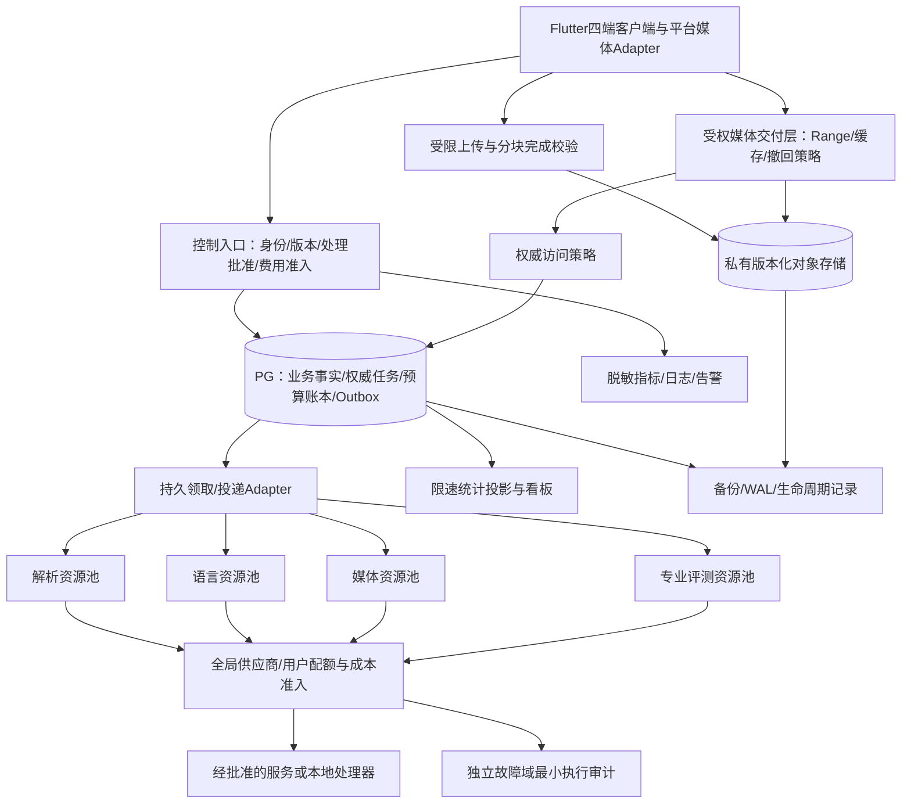

# 拾语：修订架构与扩容运维设计 v0.2

2026-11-11。承接v0.1各专业方案与本轮五方独立报告，以《技术架构联合评审结论-v0.2》的校正后意见为准。本文补充运行设计，不重画产品、不删四端/专业纠音，不表示已部署、压测或采购。实现与验证仍受立项/需求及具体数据、服务、预算授权门禁约束。

## 1. 修订后的推荐拓扑

API控制与大字节传输分开：业务接口不整文件缓冲转发视频；媒体交付层可由适合的代理/存储/分发能力组合实现，是否采用CDN待流量、地域、费用和权限语义验证，不自动采购。静态方案中的独立框表示逻辑职责，验证阶段不要求每块都一台机器。

## 2. 客户端与媒体契约补充

- Flutter继续主推荐。目标是四端都完成上传、听读、原声录音、真人视频保存/回看和恢复；camera主包没有桌面、video_player官方无Windows实现属于适配缺口，不假装所有端一个插件即通。
- 固定平台能力清单：包/原生实现、支持的OS与架构、采集/编码/播放格式、暂停续录/镜头/音频焦点/后台限制、签名与维护/许可。每项填官方声明和实机证据两列，不相互代替。
- `capture_profile`记录平台/设备类别、输入设备与路由、实际采样率/声道/可知位深、AGC/降噪/回声处理配置及未知状态。设备未暴露时标unknown，不假称已关闭；原始人声、处理后作品、专业评测各自保留谱系。条件变化分组或重新校准，不混连一条进步曲线。
- 大文件上传使用明确upload_session/part标识、大小和完整性约束、已完成分片查询、过期续签与最终校验；提交前重验账号归属和对象键。未完成分片/临时录制文件有可见保留与清理规则，用户草稿不因自动清理静默丢失。
- 录制/上传/解码采用有限缓冲与临时文件，不把整段视频放内存或转base64跨层传输。移动流量、低电/低存储、中断、进程退出和临时引用失效各有用户选择与可恢复状态。
- v0.11正文→进度/播放→练习按钮→最底词卡的顺序固定。两行是普通字号视觉目标；大字号/小屏允许自适应，不能靠裁字或缩小触摸命中区维持两行。

## 3. 数据库、队列与全局准入

1. PG仍为权威事实。初期队列可共库，但任务热集合、不可变历史尝试、append-only费用分录和分析投影分逻辑域；正文/音视频大制品放对象存储，少量结构化参数不强制全部外置。
2. 每类进程有连接池/查询/事务预算，按资源池分并发；预留管理与恢复连接。领取仅短事务，外部请求/转码期间不持数据库锁。预算按账户或约定额度粒度锁，不一把全局串行锁；SKIP LOCKED只用于领取候选。
3. 轮询退避、小批领取、到期索引、最老任务与租户公平性；高频心跳有间隔和批次上限。监测MVCC死元组、autovacuum、长事务、WAL归档和磁盘余量；不靠日常VACUUM FULL解决在线负载。
4. 投递Adapter尽量复用经核验的成熟实现。Procrastinate是PG-backed候选、Celery/Broker是另一候选；维护、崩溃恢复/重试、同事务入队、授权与schema升级测试后再锁定，当前不安装。不让底层库自动重试未知付费操作，业务任务/账本仍归平台。
5. 持久任务/Outbox提交与可丢失的唤醒信号分清。若通知失败，轮询能发现已提交记录；采用同事务NOTIFY的实现须处理通知失败导致整次提交失败，不返回虚假接收成功。
6. 每个供应商/地域/模型/任务类型全局并发和速率准入，再叠用户用量和公平队列。交互评测不能被批量导入占光。多实例不能各自算一个“全局桶”；Worker扩容受同一权威限额约束。
7. 费用批准/预留/调用/实耗/释放状态分开；执行前复核权限和额度。未知挂起核查，不能因租约过期/网络超时自动释放或重发。对账任务按批准频率核对可取得的供应商用量，差异列待核查，不自动退款或当作零。

## 4. 媒体撤回的两种可选策略

| 策略 | 可以承诺 | 代价与验证 |
| --- | --- | --- |
| 严格新请求核权 | 交付层对每个新受保护请求校验当前策略，撤回后不再放行新的有权读取 | 媒体层本身需可扩容、Range/权限缓存策略受控；不意味着已建立流或已缓存字节消失 |
| 明确残余短凭据 | 停止签发新许可；已签发凭据在约定窗口内可能仍可发起读取 | 适合卸载字节到私有存储/受控分发；必须向用户说清残余窗口，不能再承诺所有新GET立即拒绝 |

这两种不能混为同一个“立即撤回”承诺。原文/私有成绩与发布作品可采用不同策略；最终取舍、凭据/授权缓存期限由产品与技术共同批准。播放中的流、Range新请求、合法端缓存与外部副本分别定义；不在无测试时假定一种S3兼容存储/CDN都等同AWS文档。

## 5. 备份与恢复：先保护真实副作用

### 备份清单

- PG基础备份与连续WAL，归档失败和可恢复点可观测；副本不代替备份。
- 对象版本/清单、未完成上传、生命周期/删除记录，以及配置、密钥引用、签名材料的受控备份；不把密钥复制到通用日志或无保护备份包。
- 外部调用前持久化稳定业务操作键与最小提交意图到受控执行审计，收到请求引用后补充；独立于主库恢复点、具备保留和访问验证。它不创造跨系统原子事务，丢失间隙仍可能需要未知核查。
- 最小删除/撤回/来源撤权记录应可在灾后重放，避免恢复旧快照将私有删除或访问决定复活；字段、保留期和备份物理删除政策另定。

### 恢复顺序

1. 停新任务派发、付费外部调用、发布和自动结算，隔离旧Worker；创建新的恢复代际，防止旧租约继续提交。
2. 记录故障范围、恢复点和可能丢失的时间窗口，恢复PG与必要配置；核验备份/WAL完整性。
3. 先重放有效删除/撤权/撤回决定，再核对对象版本与DB引用。大规模清单可按版本/批次核对，不能把全桶无界扫描放在请求路径；缺失或孤儿进隔离清单，不自动大规模删除。
4. 对照独立执行审计、供应商请求/回调/账单与已存在制品，重建未知尝试和费用。业务幂等键不因恢复代际变化而变成新的购买操作；不能查询/幂等的外部操作保留人工核查。
5. 验证授权、余额/预留、Outbox/消费去重、词本/成绩和跨端版本。先开放安全读取，再按资源池限量恢复新执行，由责任人确认。
6. 留下实际恢复点、耗时、未恢复/待核查项和费用差异；不能以数据库可启动宣布产品全部恢复。

RPO/RTO按材料/练习/账本和访问策略分别提出目标并批准，再用隔离演练取得证据；当前未选择托管档位、备份频率或恢复分钟数。

## 6. 容量模型与扩容动作

| 负载/瓶颈 | 先观察什么 | 确认原因后的动作 |
| --- | --- | --- |
| API | 请求P95/P99、CPU/事件循环、内存、连接池等待 | 重活外移、优化热点；无本地权威状态后增API副本，并同步调整全局连接/配额 |
| 解析/语言/媒体/评测 | 到达/完成速率、最老可执行年龄、运行/等待耗时、OOM/临时盘 | 限输入/并发、资源池隔离，按具体池扩副本；供应商受限时排队/申请正式配额而非盲扩 |
| PG | 连接、锁、IO、WAL、清理、慢查询、复制/归档滞后 | 索引/短事务/热集维护/投影限速，评估连接代理、存储或实例升级；分析读再考虑副本，不用延迟副本核权 |
| PG队列影响OLTP | 空轮询率、领取延迟、最老任务、死元组及业务延迟共同恶化 | 优化后仍不能达目标才迁成熟投递层；保留稳定ID、权威状态和切换核查，禁止双队列同时执行付费步骤 |
| 媒体和对象 | 首字节/Range失败、并发流、出网、每用户GB、版本/孤儿量 | 独立交付层、受控缓存、合适码率与生命周期；CDN依据费用/地域/撤回策略验证 |
| 存储单写能力 | 经优化/隔离后仍有实证单主瓶颈 | 先拆可重建投影/独立域，分库分片最后评审；预算事务和跨用户分享会受影响，不承诺无改造 |

容量表需要填写：活跃/峰值用户、每人材料/页数/音频视频秒、生成步骤与每步耗时、码率、版本和保留天数、供应商配额、预算及部署地域。

计算口径：在途需求约为λ×平均占用时间；数据库连接上界合计所有API进程/Worker/后台/维护池；媒体带宽约为同时播放人数×平均码率；存储约为新增秒数×码率÷8×保留与版本副本系数。它们是规划公式，不是容量测试结果，平均值不能替代尾延迟和故障余量。

扩容无固定先后：依据观测扩真实饱和资源。自动扩容必须有副本、预算和供应商限额上限，事故中不自动购买额度或跨地域转移用户数据。

## 7. 最小可运维阶段与发布

| 阶段 | 推荐候选部署与底线 |
| --- | --- |
| 合成/本人受控验证 | 可共宿主，API与各Worker独立进程和资源限额、数据库私网/本地受限、私有制品、独立备份/告警；明确非HA，不先承诺固定SLA |
| 受邀灰度 | 优先评估托管PG和对象存储降低维护；重媒体执行与应用分故障域；监控与备份/恢复、成本停止、用户反馈和人工处置闭环，具体规格待预算 |
| 公开服务 | 按批准目标设跨故障域应用副本、数据库故障转移、媒体分发与容量；真正演练切换才称HA，多地域双活不默认引入 |

CI与发布需固定依赖/构建出处、许可清单、开发/测试/生产身份、签名材料权限、制品校验。迁移单独执行，先expand/兼容读写与回填、灰度稳定后contract；不能多个API实例启动时争跑迁移。老客户端/Worker兼容窗口和端侧缓存迁移要有用例，DB回退不等于降应用版本。

功能开关分“显示入口/允许新执行/允许历史读取”，停新生成时尽量保留旧学习成果；权限和费用不明仍拒绝新高风险动作。报警责任、响应窗口、处置/恢复批准人由用户实际资源确定；AI可协助，不宣称已有24小时值班。

## 8. 下一批交付与证据状态

| 任务 | 负责人 | 本轮完成到哪 | 下一份可审阅结果 |
| --- | --- | --- | --- |
| A01/A02端能力与采集 | 客户端＋测试/数据 | 官方差异和设计补项已记录，未实机 | 四端依赖/能力矩阵、capture_profile契约、限范围验证单 |
| A03/A04队列与全局准入 | 后端＋数据/SRE | 资源/事务/通知与成熟库取舍已补，未实现 | 连接/并发预算、领取/核查/账本状态与故障用例 |
| A05媒体与大文件 | 后端＋客户端 | 控制/数据面和两种撤回策略已补，参数未定 | 上传会话/分块/完整性、Range/缓存与撤回契约及成本估算 |
| A06/A07恢复与发布 | SRE＋测试 | 冻结/对账/生命周期恢复、迁移及阶段拓扑已补，无演练 | 资产恢复清单、RPO/RTO候选、灾后重复调用用例、告警与处置计划 |
| 范围与许可 | 产品＋各专业 | 四端/专业纠音不删，公开和外部代发继续分期 | 立项/范围决议、设备/账号资源表、依赖/内容权利清单 |

本轮解决的是方案缺项与取舍表达，不将“已写清”标成“已验证”。对应契约、有限样本/服务/设备/费用和实现范围获批准后，才能运行验证；核心验证不达标回方案评审，之后才承诺实施排期与上线。
