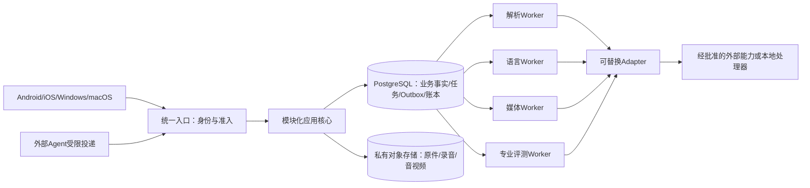

# 拾语后端与任务处理技术方案 v0.1

日期：2026-11-11。角色：后端负责人 Agent。状态：供立项及需求评审使用的候选方案，未实施。依据首席架构师方案、v0.8三方评审和用户认可的v0.11原型。研发资源按AI Agent为主、用户做产品决策与人工验收考虑。

本轮没有编写业务代码、安装依赖、调用供应商、采集真实材料或执行付费验证。框架版本、云地域、供应商和报价仍须核实；本文不承诺吞吐、效果或上线日。

## 1. 推荐路线及取舍

首选 **Python + FastAPI 的模块化核心，PostgreSQL 为事实与任务权威源，私有对象存储保存制品，按资源隔离的独立 Worker 执行长任务**。文件解析、ASR、语言生成、TTS、专业评测和发布渠道通过可替换 Adapter 接入。

候选实现组合：Python 3.12系列、FastAPI/Pydantic、SQLAlchemy/Alembic、PostgreSQL、S3兼容对象存储；媒体 Worker 使用受限环境中的FFmpeg。具体受支持版本与许可在选型时核对，不表示本机已安装。Python主要复用文档/AI处理生态，核心、Worker和契约模型共用语言，减少AI研发需要同时维护的后端栈。

第一阶段不默认引入Kubernetes、Kafka、Temporal、Dapr或每个Module一个微服务。队列先采用PostgreSQL持久任务表和可替换投递Interface；按租约领取、独立进程轮询，通知只用于唤醒。若真实压测表明数据库轮询/吞吐不足，再加Redis或专用Broker；Broker从来不成为任务或费用的唯一事实源。

替代路线为TypeScript/NestJS核心加Python处理Worker：若客户端/未来维护人员强依赖TypeScript可再比较，但会多出跨语言契约生成和两套依赖管理，目前没有证据支持立即采用。

核心进程/数据库仍是共同故障域，不能承诺“模块互不影响”。Worker独立并发、内存/CPU/时长配额及失败队列，目标是媒体故障不拖垮读词、复习和已生成内容。

## 2. Module、Interface与数据归属

初期可共用物理数据库，各Module只写自己的逻辑命名空间；跨Module通过Interface调用，不偷写对方表。核心进程内使用应用层Unit of Work协调必要的同库事务，避免拆成网络事务。

| Module | 小而稳定的Interface草案 | 唯一写入事实 |
| --- | --- | --- |
| 身份与授权 | authorize(actor, action, resource)；grant/revoke | 账号、设备会话、Agent scope、处理确认、来源授权 |
| 素材接收 | accept_delivery；prepare_upload；finalize_upload | 接收回执、投递去重、上传状态 |
| 材料与版本 | create_revision；get_source_excerpt | 原件引用、提取结果、来源页码/时间锚点、纠错版本 |
| 学习内容 | propose_units；revise_unit；approve_plan | 忠实/适级表达、单元/句子版本、已批准处理计划 |
| 持久任务 | submit_plan；get_job；request_cancel；reconcile | 任务、步骤、尝试、租约、取消与核查记录 |
| 媒体制品 | get_artifact；create_media_request | 音频、字幕、视频、句子时间轴及生成谱系 |
| 语音与表达 | assess_recording；get_assessment | 原始录音、质量判定、专业声学结果、表达评价及各自条件 |
| 学习会话/复习 | append_learning_event；save_progress；record_attempt | 版本进度、帮助条件、作答记录、词句收藏与复习事实 |
| 分享与作品 | create_snapshot；set_access；revoke_share；get_channel_status | 私有作品草稿、固定发布版本、可见范围、渠道回执 |
| 用量 | authorize_and_reserve；record_usage；settle/reconcile | 批准额度、预留、实耗、调整分录；不原地覆盖历史 |
| 资产管理 | request_export/delete；get_receipts | 用户选定范围、各Module执行回执与未完成项 |

Interface还包含不变量、错误、调用顺序和版本兼容规则，而不只是一组函数名。评审后形成OpenAPI与事件Schema，再由契约生成客户端类型；当前不以本表当冻结接口。

## 3. 数据和版本最小模型

| 事实 | 最少需要的字段与约束 |
| --- | --- |
| SourceDelivery | owner_id、integration_id、delivery_id、source_ref、source_revision、received_at；账号+接入方+投递ID唯一 |
| MaterialRevision | material_id、revision_id、owner_id、parent_revision、source_artifact、extraction_revision、page/time anchors、content_hash |
| LearningRevision | learning_revision_id、material_revision_id、unit_id、sentence_id、expression_variant、goal、approved_by、revision_hash |
| MediaArtifact | artifact_id、owner_id、learning_revision_id、sentence anchors、type、status、object_key、generator/voice/version、input_hash |
| ProcessingPlan | plan_id、owner_id、step definitions、data destinations、provider/model versions、estimate version、approved_limit、consent_id、plan_hash |
| Job/Step/Attempt | job_id、step_id、attempt_id、plan_hash、state、lease_owner、lease_deadline、fencing_token、provider_request_id、reconcile_after |
| BudgetLedger | owner_id、job/step/attempt、entry_type、unit/currency、amount、provider_usage_ref、dedup_key、recorded_at |
| Assessment | recording_id、task_type、prompt/help condition、quality result、provider/model/version、acoustic dimensions、expression judgment、sample validity |
| ShareSnapshot | snapshot_id、author_id、version、explicit artifact manifest、access policy/version、revoked_at、channel intents |

原文、学习表达、时间轴、词句本定位和复习题目必须绑定明确版本。局部修订创建新revision；旧练习和成绩仍指向旧版。只对受影响的单元重新生成依赖制品，输入指纹相同且权限仍有效时复用已有结果。无法可靠映射旧句时让用户继续旧版或看差异切新，不按百分比迁移到错句。

不同用户即便文件哈希相同，也不因此共享私有制品或泄露是否存在；初期只做账号内去重。跨用户共享缓存须有独立许可与隔离评审，非本方案默认能力。

## 4. 一条材料到学习的执行链

1. 账号准入后建立私有上传/口述草稿，校验文件类型、大小、完整性。上传成功不等于提取或生成成功。
2. 本地可完成的轻量格式探测不外发；需要云OCR、ASR、模型处理前先展示数据去向、范围、估算与上限。授权提取不自动授权英语生成、评测或公开。
3. 提取步骤产生带页码/时间位置的文本与疑点、缺失清单。用户可纠错、补传或只处理可读部分；空结果不能伪装为完整成功。
4. 生成单元和表达方案；用户确认本次处理计划。批准的计划指纹包含目标、输入版本、外部处理目的、供应商/模型及费用约束；超出已批准范围的变更重新确认。
5. Worker按依赖图执行：提取/ASR → 英语表达/单元 → TTS与对齐 → 练习题；字幕视频可在音频之后独立生成。失败只续做对应步骤。
6. 文本和音频已完成时可先学习；视频结果未知或失败不阻塞听读、查词和复习。题目与参考音频固定关联版本，避免局部改写使题目答案失效。
7. 录音先做质量判断，再分别进行专业声学评测与回应内容评价。ASR转写可校对，但不能通过校对文字改变声学分；短样本、噪声、服务不支持该任务时返回未评测或样本不足。

专业发音评估必须采购或自建符合任务的声学能力。Adapter须声明支持照稿、关键词复述、自由表达中的哪些任务、哪些维度，不把“能转写”当“能纠音”。题目合理性、地道英语和多合理回复集合需内容审核与纠错入口，不能只靠结构Schema保证正确。

## 5. 状态机、租约与未知结果

任务展示总体状态，执行和计费必须追到每个步骤/尝试；不能只保存一个progress百分比。

| 状态 | 含义与允许动作 |
| --- | --- |
| awaiting_approval | 尚无有效计划批准，不派发付费步骤 |
| queued / running | 已准入或执行中，可查当前步骤；请求取消不直接转cancelled |
| retry_wait | 已证实可安全重试的失败，限定次数和退避 |
| outcome_unknown / reconciling | 调用可能已生效，先以供应商请求ID核查；禁止盲目重发同一昂贵步骤 |
| cancel_requested | 已请求停止，阻止尚未开始的后续步骤；运行步骤等待确认 |
| cancelled / succeeded / failed | 有终态证据；保留已完成部分和实耗，不等于供应商退款 |
| partially_completed | 可用制品已保留，局部缺项明确；不是整份材料成功 |

领取任务采用行级锁/租约和单调fencing_token，防止两个Worker同时提交同一步骤成果。进程崩溃后不能仅因租约到期就认为外部调用未发生；先查看attempt是否进入外部提交区间。若不能判定，转outcome_unknown。

外部调用通常无法与数据库做同一个原子事务。供应商支持幂等键时使用稳定的step operation key；调用前记录意图，拿到请求ID立即持久化。供应商不支持幂等或结果查询时，结果不明要挂起并人工核查，不能宣称“exactly once”。回调验签、按provider event/request ID去重，迟到回调只更新同一attempt，不启动新任务。

取消会停止可阻止的新步骤；可取消的外部任务发出取消请求，等待回执。不能取消的等待终态并结算；不得提前释放仍可能消耗的额度或计算资源。Adapter停用先拒新执行，核查/排空旧任务并保留历史结果读取能力。

## 6. 预算准入与账本

同库事务调用授权、用量、任务各自所有者Interface：锁定账号预算范围 → 复核授权与计划hash → 检查可用额度 → 建立唯一预留 → 标记步骤可派发 → 写Outbox。任何一项不成立均不产生新的外部调用。不能让“检查预算”和“预留额度”分成无锁的两个请求。

Worker在真正提交每个外部步骤前再次复核计划批准、来源/资源权限及预留有效性。撤权与开始调用之间的竞态通过准入版本、开始执行记录及短事务序列化处理；已开始的调用按取消契约处理，不承诺瞬时撤销已送出的数据。

账本分estimate、reservation、provider usage、settlement、release/adjustment；金额/用量单位显式区分，不把token、字符、音频秒数混成一个数。每条分录用业务dedup_key保证平台不重复记账。供应商实耗和平台对用户的计费规则分层记录，不能把平台不重扣解释成供应商不收费。

未知实耗保留待核查项及必要预留，不自动释放。只有确认终态后才结算或释放未用部分。估算无可靠上界的任务不能假装存在绝对成本上限：应先限制输入/最大输出/时长与并发，或保持待确认，明确供应商计费风险。用户上限控制平台发起的新步骤；对已批准、不可取消调用的供应商结算偏差另行说明，不能静默继续追加调用。

## 7. 身份、外部Agent与私有隔离

- 生产身份建议接入成熟OIDC能力，具体登录方式和身份供应商待产品/客户端共同决定；不自建复杂密码认证作为一期附带工程。
- 账号归属只能来自服务端已验证身份，不采信请求体owner_id。所有资源查询和下载都校验主体与策略；数据库RLS可作额外防线，不能替代应用授权和任务执行复核。
- 外部Agent先验证受限投递入口：短生命周期/可撤销凭据，限定账号、接入方及receive:create等scope。接收权不包含读取私人材料、自动执行生成、分享或读取其他应用的权利。密钥散列保存并避免日志输出，客户端不存服务端供应商密钥。
- 投递回执包含receipt_id、material_ref、accepted/duplicate/update_pending等状态；重复投递返回同一接收结果。内容指纹相同但投递ID变化可提示重复，不能静默覆盖原件。
- 平台Agent未来读取来源需独立授予来源、时间窗口、范围与用途；每次新读取检查撤权。停止授权读取、取消处理、删除已存历史是三个动作，不共用一项默认勾选。当前不启用定时读取。

## 8. 分享、导出与删除

私有学习记录、作品草稿和发布快照是不同对象。确认发布时创建明确制品清单的不可变快照，原文件、录音、发音成绩、私人点评与词句本均不自动包含。作者改草稿不自动更新别人已看的版本。

分享读路径实时检查发布状态/可见范围。需要可撤回语义的媒体读取通过授权网关，不长期下发可绕过状态检查的对象存储URL；若采用短期签名下载，需明确有效期和已发出凭据的剩余窗口，不承诺即时收回缓存字节。撤回后拒绝新的访问请求；已经传出的数据、本地导出和第三方副本不能由本站保证收回。

渠道状态分开记录：未发送、已导出、已调起、已提交审核、已公开、失败、结果未知。无可靠回执不能显示已公开。抖音直接发布待能力申请，小红书当前是送入发布流程，视频号普通作品直接代发未核实；外部导出不依赖这些接口，一期不把统一代发放入承诺范围。

导出/删除作为可追踪任务，由各Module所有者返回分项回执。删除先按已确认范围阻止新访问，再处理原件/派生制品/索引/缓存；保留待处理项和必要审计记录，保存期限与法定/合同要求需另定。撤回材料不无差别抹掉他人的独立学习成绩；导出包要列出未完成内容。提交删除请求不等于清理完成，不能把失败项隐藏。

## 9. 上传、链接与执行隔离

上传对象名由服务端生成，先进入私有隔离区；校验扩展名、MIME、文件签名、压缩展开量、页数/时长及资源上限。解析不执行Office宏，不把任意用户输入拼接进shell。解析器无核心数据库凭据，网络默认关闭，按任务提供最小只读输入和受限输出目录。

网页提取经受控出网Adapter：只允许明确支持协议，限制重定向、大小和超时；每次解析DNS及每次重定向复核目的地址，拦截loopback、内网、链路本地和云元数据地址，避免SSRF及重绑定。需要登录的网页不借用用户电脑会话，不盲抓登录后内容；可改贴正文或传截图。媒体解码和渲染独立资源池，异常文件不能占满核心进程。

日志默认只记录资源/任务标识、状态、耗时及计费单位，原文、录音、凭据、带访问令牌URL不进入通用日志或事件总线。需要内容排障时另行最小授权并限定保留时间。

## 10. 契约与事件草案

统一结果元数据：request_id、resource_id、resource_revision、state、error_code、retryability、reconcile_required、consent_required；异步操作接收后返回202与job_id，不伪装同步完成。资源修改带expected_revision；冲突返回可处理的版本冲突，不静默最后写入覆盖。

建议稳定错误类：AUTH_REQUIRED、SCOPE_DENIED、REVISION_CONFLICT、UNSUPPORTED_INPUT、PARTIAL_EXTRACTION、CONSENT_REQUIRED、BUDGET_NOT_CONFIRMED、BUDGET_EXCEEDED、QUALITY_INSUFFICIENT、PROVIDER_UNAVAILABLE、OUTCOME_UNKNOWN、SHARE_REVOKED。retryability表示具体动作是否安全，不能一律“点重试”。

事务Outbox发布事实事件，消费者Inbox按event_id去重。初始事件：MaterialAccepted、MaterialRevisionCreated、PlanApproved、StepStarted/Terminal、UsageRecorded、LearningAttemptRecorded、SharePublished/Revoked、AssetOperationUpdated。事件只带schema_version、event_id、actor/owner_id、aggregate_id/revision、occurred_at、correlation/job_id与必要状态；不携带整段内容。至少一次投递、乱序与迟到为默认，统计投影可重建，不能作为撤回准入唯一依据。

## 11. 评审后要先验证什么

| 验证包 | 通过证据 | 当前状态 |
| --- | --- | --- |
| 专业声学与表达 | 批准样本覆盖照稿/提示/自由回应、安静/噪声/过短；质量不足拒评，反馈可行动且可回溯服务版本 | 尚无服务和样本授权，不执行 |
| 内容与时间轴 | 文档/PPT/PDF/扫描/音视频代表样本，缺失能发现，局部修订不使时间锚点错位，合理回答不被误判 | 方案待定，无实测 |
| 任务/账本故障 | 并发预算争抢、重复投递、Worker崩溃、调用超时、取消、迟到回调；无重复平台分录，未知不盲重发 | 需合同与故障用例后实现验证 |
| 权限生命周期 | 两账号越权、撤权后新执行、分享撤回、旧签名窗口、部分导出/删除回执 | 需先定承诺语义 |
| 四端联调 | 各端上传、录音格式、蓝牙/后台/中断、跨端版本冲突，后端原始录音和帮助条件一致 | 由客户端/测试组织实机，不能由后端接口成功代替 |

每个外部验证先提交服务、样本、数据去向、预算上限与保存规则，经授权后执行。当前可先在需求评审中冻结状态和契约，不以未验证能力承诺开发完成或上线。实现顺序建议：账号隔离/版本/任务账本纵切 → 私有材料到听读 → 录音评测与复习 → 四端续学 → 作品与分享；这是依赖建议，实际迭代范围由产品立项决议确定。

## 12. 本轮待决策与跨端依赖

1. 产品/架构确认本主路线和一期分期，明确哪些能力进入首轮验证，而非默认全部功能同批上线。
2. 明确可用部署地域、身份与对象存储条件；供应商处理地域、保留政策和计费单位纳入同一评审。
3. 技术验证前确认样本与服务预算，接口联调前冻结客户端录音/版本/帮助条件契约。设备、签名、上架账号由客户端列条件，本后端方案不假定已具备。

这些事项不阻塞当前编写方案，但在各自依赖节点前必须关闭。下一步是跨专业交叉评审与需求契约收口，不是直接部署。
