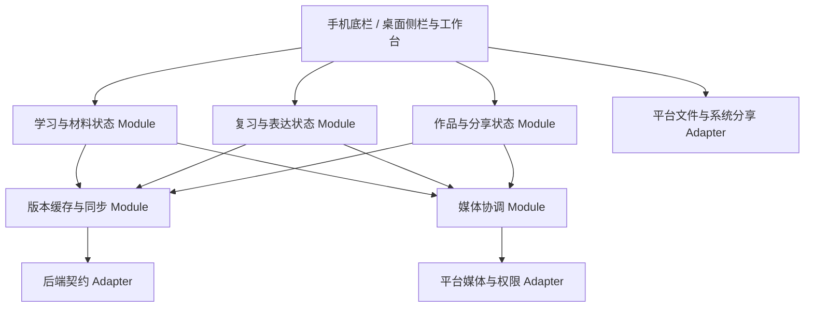

# 拾语四端客户端技术方案 v0.1

日期：2026-11-11。状态：技术方案草案，供立项与需求评审。依据已确认的 v0.11 原型及 v0.8 三方评审；用户确认首轮主要由 AI Agent 开发、本人负责产品决策与人工验收。本稿不代表栈已冻结、供应商已选定或开发已获批准，未下载 SDK、安装依赖、执行真实录音或调用外部服务。

## 1. 主推荐与取舍

**主推荐 Flutter 统一 Android、iPhone/iOS、Windows、macOS 客户端。** 共用设计系统、阅读/复习状态、协议模型与大部分 UI，用平台 Adapter 封装文件、媒体、权限和系统分享。理由是当前以 AI Agent 为主，维护一套 UI/业务语言比同时维护移动与桌面两套 UI 更容易控制变化；这不是已经证明全部插件在四端可用。

| 路线 | 收益 | 真实成本与风险 | 本项目决策建议 |
| --- | --- | --- | --- |
| Flutter 单一客户端栈 | 四端共用 Dart 模型、状态与大量 UI，手机底栏和桌面侧栏按宽度适配 | 各端相机、后台音频、蓝牙与分享能力不对称；必要时仍需 Swift/Kotlin/Windows/macOS 原生 Adapter；包体与桌面输入体验需验证 | 优先做能力清单与获授权的最小验证；核心媒体矩阵通过后再冻结为首版栈 |
| React Native 移动＋React/Tauri 桌面 | 可共享 TypeScript 契约、部分状态逻辑，网页式桌面较方便 | 两套渲染和原生媒体适配；React Native 与 Tauri 插件不可混用；桌面采集/编码与系统 WebView 差异仍存在 | Flutter 某项关键能力无法合理满足时的备选，不因熟悉 React 就默认四端已通 |

不把 PWA 当作满足四端原生后台、相机、录音、文件和发布的证明，也不直接从现有静态 HTML 继续堆业务。现有原型只作为设计与验收依据。包管理版本、状态库、媒体插件和最低 OS 版本在验证报告后列出并固定，本稿不声称已查验最新官方兼容表。

## 2. 客户端结构与职责

| Module | 小 Interface 与约束 | 不由它承担 |
| --- | --- | --- |
| 材料与上传 | `prepareSource → draft`、`uploadDraft → receipt`、`resumeUpload`；原件/私有草稿先与来源关联 | 不在 UI 内做云服务鉴权、直接调用供应商或运行 Office 宏 |
| 阅读与学习 | `openLearningVersion`、`selectSentence/Word`、`requestProgressUpdate`；句段锚点总带版本 | 不修改材料历史版本或按百分比猜测新版位置 |
| 媒体协调 | `play(asset,range,purpose)`、`pause(reason)`、`record(context)`；协调唯一音频输出和采集会话 | 不把 ASR 转写相似度算成发音分，不写供应商计费规则 |
| 复习与表达 | `presentItem`、`recordAssistance`、`submitAttempt`；选择/试听/提交是不同动作 | 不从单次答对推导长期掌握，不以唯一参考句否定自由回答 |
| 作品与分享 | `createDraftFromPractice`、`editCaptions`、`export/launchChannel`；始终使用确定的作品版本 | 不将平台调起标成已发布，不把字幕修改反写到声学评测 |
| 缓存与同步 | `readVersionedCache`、`appendEvent`、`sync(baseRevision)`；离线队列可追踪、用户隔离 | 不替代服务端权限、预算准入、幂等与正式事实记录 |
| 平台 Adapter | `requestCapability`、`pickFiles`、`startCapture`、`exportFile`、`launchShare`；返回明确能力/状态 | 不把未知权限或缺插件静默降级成另一种操作 |

设备文件句柄、系统权限和供应商格式分别封装；页面只处理平台契约。客户端不直接持有 TTS/评测等供应商密钥。会话凭据使用系统安全存储，日志不写访问令牌、材料全文、音频内容或带访问权限的完整地址。

## 3. v0.11 阅读页与音频状态

固定垂直顺序：**完整滚动正文 → 时间进度/播放 → “这一句没听懂、跟读/复述” → 最底部两行词卡**。默认词卡显示词、音标、发音/收藏和简短释义，例句只在展开时出现。

- 正文是独立滚动容器，词卡拖动只调整面板高度与正文可视高度，不覆盖播放/练习按钮。小屏、横屏或大字号时先限制词卡最大高度，再在词卡内滚动，不能把正文或关键按钮挤到不可见。
- 词卡展开/收起记录并恢复“句子 ID＋句内偏移”，不因布局变化回文章开头。用户手动滚动时解除自动跟随，提供回当前句；拖动进度条预览句子，确认定位后再更新播放位置。
- 点击单词查词；句旁播放按钮控制整句，减少点击冲突。长按选择短语；无选词时小词卡显示发现提示，不自动填入不相关词。
- 查词前正在播放则先暂停；单词/例句试听不与正文叠音。收起卡片不自动续播。选择题选项喇叭也不同时选中或提交选项。
- 播放状态为 `idle/loading/playing/paused/interrupted/failed`；另记暂停原因（用户、查词、录音、系统中断）。录音、上传、等待评测另有状态，不能压成一个全局 loading。
- 系统音频焦点丢失、蓝牙切换或来电时先保存状态；是否可恢复由平台能力及用户动作决定，不能静默开麦或恢复一段已被用户暂停的声音。
- 时轴、音频及字幕绑定同一学习版本。缺可靠时轴时显示普通播放和单元选择，明确逐句定位暂不可用，不造假时间戳。

## 4. 文件、录音与真人视频

四端都支持从本机文件选择器添加文件；允许手机导入文档，不要求固定从电脑上传。内容路径统一为上传文件、粘贴内容、说一段；加号不承接练习录像。文字/链接先存私有草稿，OCR/转写等外部处理仍须后端提供范围、数据去向和费用准入。

文件选择后先检查可读性、格式、大小等配置限制；限制来自后端能力声明，不硬编码“任意大小都支持”。跨端的文件路径不能直接共享，上传使用文件实体和校验标识；原始文件移动、系统撤销授权或移动端临时引用失效时给重新选择入口。大文件分块/续传能力须与后端契约一致，不擅自宣称能断点续传。

| 录制用途 | 行为与保存 | 后续处理 |
| --- | --- | --- |
| 口述素材 | 本地录音/暂停/试听，存私有草稿，明确中英均可 | 确认转写范围与费用后上传转写，不自动算作发音练习 |
| 跟读/自由回答 | 保留原始人声和任务类型、提示条件、质量信息 | 专业评测由后端受控提交；太短/无声/噪声不合格不出伪分 |
| 作品录音/真人视频 | 用户主动选模式、开麦/开镜头，录制前预览、结束后试听/回看 | 保存作品草稿，校字幕、选片段、独立预览外发；原声与作品版本关系保留 |

真人视频模式选中不等于摄像头已打开。点击开启或开始录制前，按平台流程请求相机/麦克风；拒绝后允许重试或主动改为录音，不静默替用户切换。录制前没有假计时，录制中才出现时长和停止。前后镜头切换能力按设备验证；只有单摄像头的电脑不给无效切换按钮。

优先保留设备可用的原始录制格式，再经已批准媒体流程标准化。采样率、声道、编码、最大长度与上传切片由选定评测/媒体契约确定，不先假定所有服务都接收同一音频格式。相机帧率、方向旋转、镜像、字幕安全区和音画同步都需验证。编辑后的字幕、配乐、AI 配音不参与原始声学能力趋势。

原始评测录音与作品可选择关联，但“存学习记录”不强迫生成公开作品。系统分享只返回已调起等可确认状态；最终发布结果由平台可靠回执或明确用户确认链路处理，客户端返回前台不能直接判成功。

## 5. 本地数据、离线与跨端

- 可缓存经授权的材料文本、媒体与词句，缓存条目带账号、资源版本、完整性、过期/撤回策略和大小；用户可查看并清理。缓存配额、保留期限与退出清理策略须需求评审确认，不承诺无限空间。
- 离线可读/可听缓存不等于本机运行 ASR、TTS 或专业评测。离线录音先存本地待上传，明确“未评测”；服务不可用不补本地伪分。
- 学习行为先追加带客户端事件 ID 的记录，重连后按幂等契约同步。播放位置用 `base_revision` 条件更新；另一设备更新时返回冲突，让用户选择继续，不用最后到达时间静默覆盖。
- 同一版切设备以句段锚点恢复；材料改写、拆分或重新配音后，先展示新版差异，继续旧版或明确切新。缺有效映射就不搬旧百分比和词句定位。
- 登出/换账号先停止进行中的采集，隔离缓存与待上传队列；历史删除与撤销来源权限分开。删除请求处于等待或部分失败时，客户端不能显示全部完成。
- 私有文件或共享缓存每次获得新访问授权时受服务端核权；缓存不能成为长期绕过撤回的通道。已导出外部副本不承诺可收回。

## 6. 需与后端/数据共同冻结的字段

以下是契约提案而非已存在接口；字段命名可在联评中统一，语义不可省略。

| 契约 | 客户端需要的数据/行为 |
| --- | --- |
| 账号与能力 | `account_id`、设备会话、资源可执行动作、能力声明（格式/大小/媒体限制），不把展示开关当权限 |
| 材料与学习版本 | `material_id/source_version_id/learning_version_id/unit_id/sentence_id`、原件页码或时间锚点、改写对照与版本关系 |
| 媒体 | `media_asset_id`、编码/长度/方向、版本、句段时轴、访问失效时间；签名地址只按需获取、不记录完整值 |
| 上传/处理 | 上传凭据、校验与分块协议、接收回执、`task_id/step/status`、安全可重试标志、未知结果核查入口 |
| 处理确认与预算 | 处理计划版本、范围、数据去向、确认记录、估算/上限/预留/实耗状态；执行前后端仍复核 |
| 练习/评测 | `attempt_id/task_type`、提示条件、原始录音引用、质量状态、评测服务/模型版本与维度、未评测/样本不足原因 |
| 题目与反馈 | 题目版本、选项音频与文本、可接受回应集合/规则、答后解释；不向答前界面泄露答案，允许报告歧义题 |
| 事件与续学 | 客户端事件 ID、事件 schema、时间/时区与服务器接收时间、`base_revision`、去重/冲突结果 |
| 分享与资产 | 作品草稿/固定发布版本、包含项、可见范围、逐渠道状态/错误/未知、导出删除回执与剩余项 |

收听时间、主动开口、提示后完成、独立答对分别上报；事件不默认携带原文、音视频或不必要设备标识。看板只消费已定义条件的事实，不能由客户端随意提交“已掌握”“发音提升百分比”。

## 7. 四端能力验证矩阵

所有格均为**待验证**，目前只有静态图。每端至少选一台真实目标设备/系统版本，验证包保存设备/OS/构建版本、步骤、录屏或日志、结果与限制；模拟器不替代所有媒体和蓝牙证据。

| 验证项 | Android | iPhone/iOS | Windows | macOS |
| --- | --- | --- | --- | --- |
| 文档、照片、音视频选择与上传；系统撤销/移动原件 | 本机文件与相册来源 | Files/照片来源与临时引用 | 文件路径与系统隐私设置 | 文件授权引用与重新访问 |
| 正文、点词卡、字幕时轴、变速循环与同句恢复 | 字体/手势/导航栏 | 字体/手势/安全区 | 鼠标键盘/缩放/窗口尺寸 | 鼠标键盘/缩放/窗口尺寸 |
| 麦克风、相机及拒绝后恢复 | 权限拒绝/不再询问分支 | 权限拒绝/设置恢复分支 | 系统和应用访问开关 | 系统和应用访问开关 |
| 声音焦点、锁屏后台、来电/蓝牙中断 | 平台后台机制与通知规则 | 后台音频资格与系统策略 | 最小化/休眠/音频设备更换 | 最小化/休眠/音频设备更换 |
| 原声/真人视频、旋转/镜像/编码/长录制 | 前后摄与存储不足 | 前后摄与存储不足 | 摄像头枚举与单摄降级 | 摄像头枚举与单摄降级 |
| 断网重连、杀进程、跨账号、同版/新版续学 | 真机恢复 | 真机恢复 | 进程重启恢复 | 进程重启恢复 |
| 本地导出与外部渠道 | 文件导出/官方 SDK 待获批验证 | 文件导出/官方 SDK 待获批验证 | 文件导出与手机接力 | 文件导出与手机接力 |

没有能力证据时禁用对应动作并解释原因；正文/已完成音频/词句复习应继续可用。若核心上传、录音或专业评测媒体链路在任一确认平台不可达，需要回到技术与需求评审，不能以删掉该端结束问题。

## 8. 可访问性、分发与资源门槛

阅读区支持系统字体缩放、合理对比、屏幕阅读标签、焦点顺序、触控和键盘操作。v0.11 两行小卡是视觉目标，真实实现不能靠固定小字号和过小点击区强撑；大字号时允许词卡内容横向重排或局部滚动。发音/收藏/展开各自有可识别标签，颜色不是唯一状态标识。桌面提供键盘播放/暂停、句子定位与可见焦点，避免快捷键与文字输入冲突。

| 平台 | 必须准备的构建/分发资源 | 不能由 AI 角色替代的条件 |
| --- | --- | --- |
| Android | 可重复构建环境、签名密钥管理、测试分发与目标市场上架规则 | 真机、耳机、权限/后台测试；商店账号与签署决策 |
| iOS | 可用 Mac/Xcode 构建链、Apple 签名与测试分发资格、目标 iPhone | 不能仅在现有 Windows 主机完成全部 iOS 真机构建签名与验收；账号/费用由用户决策 |
| Windows | Windows 构建、安装包升级/卸载/回退；是否代码签名及分发渠道 | Windows 系统版本/摄像头/麦克风及安全策略验收，不绕过系统警告 |
| macOS | Mac 构建、签名/公证及分发策略、目标硬件与权限声明 | 实际 Mac 设备或获准构建资源、签名资格与真机媒体测试 |

没有 Mac、iPhone、Android 或必要账号时，方案可以继续，但不能承诺对应端已经验收或能按期分发。SDK、插件许可、官方接口申请、商店费用与硬件成本另列清单确认；本稿不报未查实价格。

## 9. 方案通过与实现顺序

需求联评先确认能力矩阵、字段与资源，再批准范围明确的验证。获授权后先验证一条纵向链路：四端各选文件→同版听读/词卡→原始录音/视频保存→重新打开与恢复；用合成或用户明确批准的材料，不自行外发工作记录。专业评测另按批准的服务与数据流执行，不与“界面能录音”混成同一通过结论。

技术选型通过条件：主路线能覆盖四端已确认的核心能力；核心插件/原生 Adapter 维护和许可可接受；跨端复用与平台差异有证据；关键失败状态可重现并恢复。验证失败写清替代方案成本，再决定保留 Flutter、局部原生补足或切备用路线，不先同时开两套产品。

只有需求基线、Interface、验收口径、资源与验证结论通过后，才进入客户端业务实现排期。当前不按33张原型图推算研发天数，也不承诺上架日期；后续由前端、后端、数据、测试共同用真实依赖和可用设备估算。
