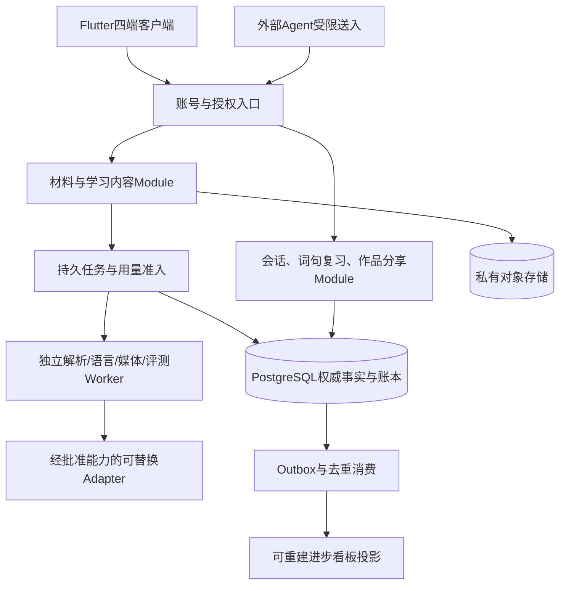

# 拾语：架构统筹与技术决策草案 v0.1

2026-11-11。当前授权：在用户认可v0.11原型后推进产品经理收口、立项草案和各端技术方案。主要由AI Agent研发，用户做产品决策和人工验收。以下是候选技术决策，不表示已批准开发、选定供应商、启动付费验证或具备所有设备。

## 1. 推荐主路线

**Flutter统一四端客户端，Python/FastAPI模块化核心，PostgreSQL权威状态和账本，私有对象存储，分资源独立Worker。** 文件、语音、模型与渠道用可替换Adapter接入；推荐先验证这一套，不同时做两套产品。

| 决策 | 主推荐 | 为什么及什么情况要重审 |
| --- | --- | --- |
| 客户端 | Flutter/Dart面向Android、iOS、Windows、macOS | AI为主研发时减少UI/状态逻辑重复；先核对媒体插件与原生补足代价，关键能力不可满足时再评RN移动+React/Tauri桌面 |
| 应用核心 | Python/FastAPI，业务Module明确数据归属 | 文档、AI与媒体生态便于统一；不是让所有异步处理跑在HTTP请求进程 |
| 任务 | PostgreSQL持久任务/步骤/尝试＋租约＋核查，执行进程分资源池 | 一期减少基础设施；队列吞吐/维护复杂度有证据后再换专用投递Adapter，不能把数据库方案当成无需可靠性工程 |
| 存储 | PostgreSQL业务事实；私有S3兼容对象存储制品；端侧版本缓存 | 三种存储的权限、生命周期、容量成本分别管理；对象存储不允许默认公开 |
| 接口 | 应用Interface＋版本化HTTP契约、Outbox事件及客户端生成类型 | 客户端不直接认识供应商SDK和密钥；异步事实最终一致不用于取代实时权限判断 |
| 评测与生成 | 先定义支持任务与验证协议，再选服务Adapter | 专业发音、自由表达、词典、OCR、ASR、TTS的支持、地域、费用和保留政策尚未确认，不为凑齐接口假定供应商可用 |

具体依赖版本、最低系统版本、身份提供方、云地域及签名分发方案需在对应验证后确认。现有HTML只是设计输入，不作为Flutter生产代码或证明四端可用。

链接分享的接收端也要收口：仅让已安装客户端接收，还是提供有限只读浏览器入口。后者不等于再做一套完整Web产品，但需要独立的访问/撤回/兼容验收；当前列为范围待决策，不默认悄悄增加第五端，也不承诺未安装App的人已可直接学习。

## 2. Module归属与可拆装

| Module | 唯一事实所有者 | 稳定Interface承担什么 |
| --- | --- | --- |
| 身份与授权 | 后端身份模块 | 校验用户/设备/Agent scope、处理批准、来源撤权及资源可见性 |
| 接收与上传 | 后端接收模块 | 投递回执、去重、上传完整性；不把接收冒充处理完成 |
| 材料与学习版本 | 后端材料/学习内容各自所有 | 原件和纠错、分单元、学习表达、来源锚点与修订谱系 |
| 任务编排 | 后端任务模块 | 执行顺序、步骤尝试、取消、终态与结果未知核查 |
| 用量账本 | 后端用量模块 | 批准额度、执行前预留、实际用量、结算与调整；不是分析埋点累计 |
| 媒体与专业评估 | 后端对应模块 | 制品和对齐、原始录音、质量门禁、评测维度及支持条件 |
| 学习会话 | 后端会话模块 | 版本进度、追加的学习/帮助事实与跨端冲突；不由看板回写 |
| 词句与复习 | 后端复习模块，数据负责人定义调度/指标 | 收藏、尝试、到期安排与提示条件，保持听辨/认义/运用/选修拼写独立 |
| 作品与分享 | 后端作品/分享模块 | 私有草稿、固定发布快照、逐渠道意图和回执、撤回 |
| 看板投影 | 数据模块 | 从有归属的事实/事件重建统计，不拥有计费或权限真相 |
| 客户端媒体协调 | 客户端 | 统一播放/暂停/试听/录制和平台能力；不是直接发起供应商付费调用 |

初期同库事务由Module Interface与统一事务上下文协调，不能让每个Agent直接跨域改表。逻辑分开不等于每个Module独立部署。需要替换的是Adapter；停用时先停新执行，再排空/核查旧任务，并保留历史成果读取。

## 3. 五份跨专业共享契约

以下先定义语义，需求评审后形成可校验Schema，不在本轮假装已冻结接口。

1. **资源与版本**：主体身份来自服务端；material_revision、learning_revision、unit/sentence anchor、media_revision和content hash有关联。写进度带expected_revision和设备/会话；新版不按旧百分比直接迁移。
2. **任务与费用**：批准处理计划绑定数据去向/版本/范围/估算及上限。准入、额度预留、任务派发记录在受控事务中一致；执行前再复核。outcome_unknown先核查，取消请求不是终态，外部费用未知不自动释放预留。
3. **录音与评测**：录制用途、任务类型、提示条件、原始音频、质量结果、评测服务/模型/版本/维度固定关联。内容评价和声学评分分离；ASR可校对，不改变原始发音事实。未支持或样本无效不能出精确分数。
4. **学习尝试与帮助**：试听、选中、提交、重听、慢放、展开文字/中文/示范分别表达；帮助发生在提交之前还是之后可辨。合理回答集合、题目版本、尝试及延迟检索可追溯，不从单次选择判断交流能力。
5. **分享与资产**：作品版本、发布快照、明确制品清单、可见范围和逐渠道状态；撤回拒绝新的站内读取，不能保证收回外部副本。导出、删除、撤权和取消各有独立范围、状态与回执。

## 4. 跨方案交叉审查必须保持的不变量

- 队列投递与Worker租约不是任务终态；租约到期也不能直接重发可能已生效的外部调用。
- 平台不重复记账不意味着供应商不收费；不能承诺未知任务、失败或取消都零费用。
- 前端缓存/分析投影不负责最终准入；后台新步骤和分享读路径仍检查权威权限。
- 可撤回媒体不能给长期绕过授权的下载地址。即使用短期凭据，也要明确剩余有效窗口，不能承诺已下载字节立即消失。
- 已上传的私有草稿与外部处理授权分离。用户可以先保存，再决定是否外发处理。
- 词卡始终在所有播放/练习按钮下方，默认两行；面板伸缩和正文滚动独立，保住当前句与音频暂停原因。
- 客户端能力按四端分别报告，不借统一代码库声称相机、后台、系统分享与签名已通。
- 生成内容、题目和声学评价的质量不能只由同一生成模型自评分证明。专业判断和经授权样本验证的证据来源须独立说明。

## 5. 落地依赖与下一道门禁

方案评审先决定一期范围、候选技术路线和共用契约。真实验证之前列清服务/版本、输入样本、外发数据与地域、保存规则、单次及总预算上限；没有授权不外发。开发者账号、macOS构建环境和四端实机是实际资源，不能用AI Agent角色替代。测试发布方式与正式上架分别评估，不自动购买账号。

可先评审无需外发的设计、状态与故障用例；运行验证所需代码与环境建设在对应范围获批后才开始。若Flutter关键能力、专业纠音或内容质量验证不达标，回到选型/产品评审，而非用弱指标掩盖。

当前推进顺序：**需求范围/立项决议→需求及各端技术方案联合评审→获批高风险验证→实现排期与开发→人工验收→灰度→正式上线→反馈迭代**。本轮交付方案包，不以文档数量、原型页数或AI角色数推算上线日。
